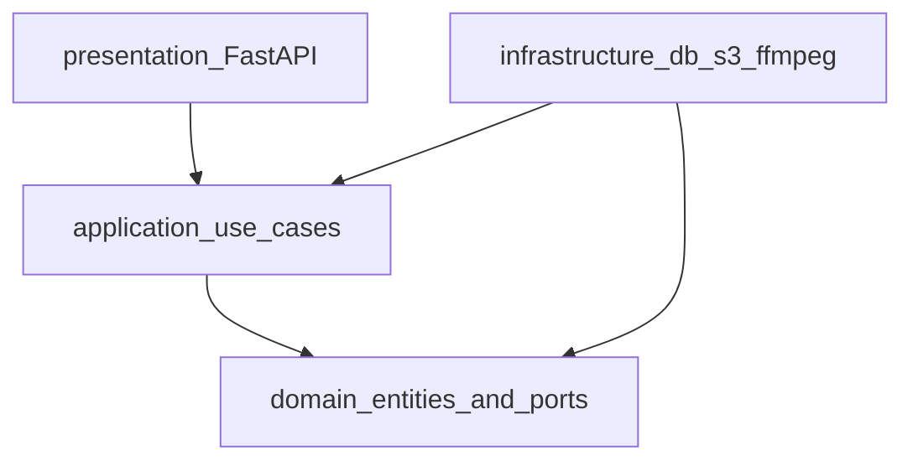

# Копия YouTube

Максимально приближенная копия YouTube, в том числе по UI/UX. Лента, страница просмотра, канал, поиск, загрузка и модерация должны быть узнаваемы как YouTube: шапка, левая колонка, сетка превью, плеер и комментарии стоят на тех же местах, что и у оригинала.

Сейчас в репозитории спецификация и дерево каталогов. Эндпоинты, вёрстка, тесты и рабочий деплой ещё не написаны.

## Стек

- Бэкенд: Python, FastAPI, SQLAlchemy 2, Alembic, Pydantic. Swagger на `/docs`.
- База: PostgreSQL.
- Видео: MinIO. Очередь обработки — таблица `media_jobs` в PostgreSQL, отдельный контейнер-воркер с ffmpeg. Один mp4, без нескольких качеств.
- Фронт: React + Vite, тёмная тема в цветах YouTube.
- Контейнеры: `api`, `worker`, `postgres`, `minio`, `frontend`.

Секреты только из окружения. Образец переменных — [.env.example](.env.example). Файл `.env` в репозиторий не кладётся.

## Деплой

Целевая команда на чистой Ubuntu:

```bash
bash deploy.sh
```

Сейчас это каркас: скрипт сообщает, что сборка ещё не подключена, и завершается с ошибкой. На шаге реализации команда поднимет compose, применит миграции и вызовет [scripts/seed.py](scripts/seed.py). После этого без ручной настройки базы должен проходить сценарий приёмки.

## Слои бэкенда

Зависимости направлены внутрь. Домен не знает про HTTP и базу. HTTP не ходит в базу напрямую.



Подробности и запреты импортов — в [backend/README.md](backend/README.md).

## Документы

- [docs/architecture.md](docs/architecture.md) — контейнеры, слои, поток загрузки.
- [docs/database.md](docs/database.md) — таблицы и кто какое видео видит.
- [docs/security.md](docs/security.md) — JWT, хеш пароля, presigned URL, роли, лимит файла.
- [docs/ui.md](docs/ui.md) — каркас и поведение экранов относительно YouTube.
- [frontend/README.md](frontend/README.md) — экраны и состояния интерфейса.

## Сценарий приёмки

Регистрация → загрузка видео → просмотр → лайк и комментарий.

Экраны: главная, просмотр, канал, поиск, загрузка, вход и регистрация, модерация.

Роли: пользователь, модератор, администратор. Приватное видео видят только владелец и пользователи из списка доступа.

## Как разрабатываем

Каждый срез поведения начинается с падающего теста, затем появляется код. Смена поведения сопровождается правкой этого README и документа в `docs/`, который это поведение описывает. Тесты лежат в `backend/tests` и запускаются так:

```bash
pytest backend/tests
```

Каркас бэкенда отвечает на `GET /health` и открывает `/docs`. Регистрация, вход и `/auth/me` работают: пароль хранится как хеш, роль при регистрации — `user`. Видео создаётся со статусом `uploading` и серверным ключом объекта. Лента и поиск показывают только открытые готовые ролики. Просмотр доступного готового ролика увеличивает счётчик, лайк один на пару пользователь–видео, чужой комментарий удалить нельзя. На канале владелец видит неготовые и скрытые ролики, подписка не дублируется, плейлист хранит порядок. Модератор скрывает ролик по жалобе, администратор назначает роли, модератор администратора назначить не может. Команда тестовой базы и `pytest backend/tests` записаны в [backend/README.md](backend/README.md).
