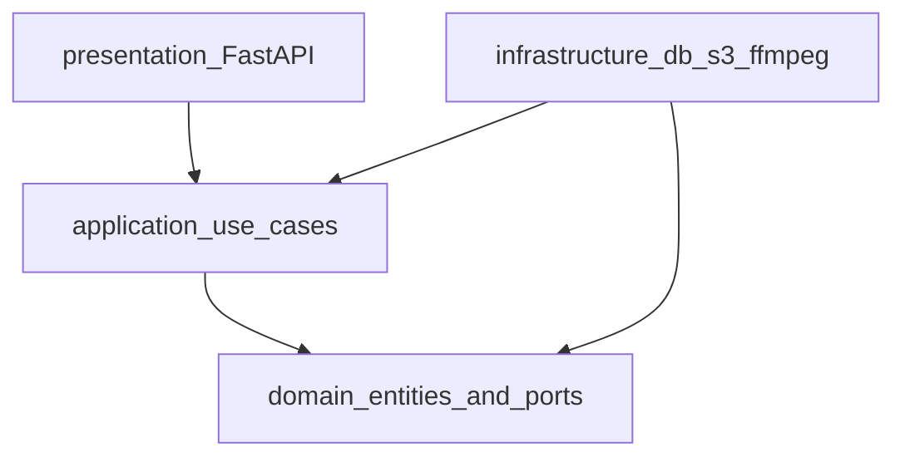

# Копия YouTube

Максимально приближенная копия YouTube, в том числе по UI/UX. Лента, страница просмотра, канал, поиск, загрузка и модерация должны быть узнаваемы как YouTube: шапка, левая колонка, сетка превью, плеер и комментарии стоят на тех же местах, что и у оригинала.

Приложение собирается одной командой `bash deploy.sh`: API, воркер, PostgreSQL, MinIO и фронтенд.

## Стек

- Бэкенд: Python, FastAPI, SQLAlchemy 2, Alembic, Pydantic. Swagger на `/docs`.
- База: PostgreSQL.
- Видео: MinIO. Очередь обработки — таблица `media_jobs` в PostgreSQL, отдельный контейнер-воркер с ffmpeg. Один mp4, без нескольких качеств.
- Фронт: React + Vite. Светлая и тёмная темы в цветах YouTube переключаются из меню аккаунта и красят оболочку целиком. В контейнере nginx отдаёт сборку и проксирует `/api` на API.
- Контейнеры: `api`, `worker`, `postgres`, `minio`, `frontend`.

Секреты только из окружения. Образец переменных — [.env.example](.env.example). Файл `.env` в репозиторий не кладётся.

## Деплой

На чистой Ubuntu с Docker:

```bash
bash deploy.sh
```

Скрипт копирует [.env.example](.env.example) в `.env`, если своего файла ещё нет, собирает контейнеры, применяет миграции Alembic и запускает [scripts/seed.py](scripts/seed.py). Если реестр образов недоступен, поднимаются уже собранные локальные образы. MinIO — образ Bitnami: данные лежат в `/bitnami/minio/data`, API стартует только после его проверки готовности. К внутреннему MinIO API подключается по IPv4 и несколько раз повторяет создание бакета, если хранилище ещё не принимает запросы. Короткая ссылка для браузера собирается сразу с регионом `us-east-1`, без запроса к `localhost` из контейнера API. Повторный сид выставляет демо-учёткам пароль `demo-pass`, если сохранённый хеш ему не соответствует. В контейнере скрипт сам находит пакет `app` в `/app`. Браузер читает и отправляет файл ролика через тот же адрес, что и страница: nginx на порту 8080 передаёт путь `/videos/` в MinIO. Если демо-файл пропал из хранилища, повторный сид кладёт его снова. Повторный запуск не создаёт вторые демо-учётки и ролики. Живой `.env` в репозиторий не попадает.

После команды интерфейс открывается на `http://localhost:8080`. API слушает `http://localhost:8000`, MinIO — `http://localhost:9000`. Браузер ходит в API через `/api` и читает файл ролика по пути `/videos/` на том же адресе, что и страница. Если Docker работает внутри WSL, а страница открывается в браузере Windows, проброс порта на `localhost` иногда не поднимается: внутри WSL ответ есть, а Windows получает `ERR_CONNECTION_REFUSED`. Тогда `deploy.sh` запускает на Windows пересыльщик `127.0.0.1:8080` → адрес WSL. Он слушает только петлю Windows и пропускает байты в обе стороны, в том числе выгрузку ролика. Повторный запуск поднимает его снова, если страница с Windows больше не открывается.

Демо-пароль у всех четырёх учёток один: `demo-pass`.

| Email | Имя | Роль |
| --- | --- | --- |
| admin@demo.local | admin | администратор |
| moderator@demo.local | moderator | модератор |
| author1@demo.local | author-one | пользователь, автор |
| author2@demo.local | author-two | пользователь, автор и доступ к закрытому ролику |

В ленте есть «Утро на канале», «Второй ролик» и «Ролик соседа». «Закрытый ролик» в ленте не виден: его открывает автор и `author-two`. На «Утро на канале» уже есть лайк и комментарий «Хороший ролик». На «Ролик соседа» открыта жалоба «Проверьте этот ролик».

Проверка после деплоя:

1. Открыть `http://localhost:8080` и увидеть демо-ролики в ленте.
2. Зарегистрировать нового пользователя, загрузить короткий mp4, дождаться обработки, открыть ролик, поставить лайк и оставить комментарий.
3. Войти как `moderator@demo.local`, открыть «Модерация», нажать «Скрыть» у жалобы и убедиться, что ролик пропал из ленты.
4. Запустить `bash deploy.sh` ещё раз: команда завершается без ошибки.

## Слои бэкенда

Зависимости направлены внутрь. Домен не знает про HTTP и базу. HTTP не ходит в базу напрямую.



Подробности и запреты импортов — в [backend/README.md](backend/README.md).

## Документы

- [docs/architecture.md](docs/architecture.md) — контейнеры, слои, поток загрузки.
- [docs/database.md](docs/database.md) — таблицы и кто какое видео видит.
- [docs/security.md](docs/security.md) — JWT, хеш пароля, presigned URL, роли, лимит файла.
- [docs/ui.md](docs/ui.md) — каркас и поведение экранов относительно YouTube.
- [frontend/README.md](frontend/README.md) — экраны и состояния интерфейса.

## Сценарий приёмки

Регистрация → загрузка видео → просмотр → лайк и комментарий.

Экраны: главная, просмотр, канал, поиск, загрузка, вход и регистрация, модерация.

Роли: пользователь, модератор, администратор. Приватное видео видят только владелец и пользователи из списка доступа.

## Как разрабатываем

Каждый срез поведения начинается с падающего теста, затем появляется код. Смена поведения сопровождается правкой этого README и документа в `docs/`, который это поведение описывает. Тесты лежат в `backend/tests` и запускаются так:

```bash
pytest backend/tests
pytest scripts/test_windows_localhost_relay.py
```

Плеер на странице просмотра рисует панель YouTube: красная шкала, громкость, время, скорость, широкий и полный экран. Системные кнопки браузера скрыты. Автовоспроизведение следующего ролика берётся из настроек браузера. Страница канала открывается с вкладки «Главная»: строка `@имя • подписчики • видео`, поиск по названию, полка «Популярные видео» и чипы «Новые / Популярные / Старые». Гид слева показывает подписки и блок «Вы». У владельца кнопка «Управление видео». Шапка вошедшего пользователя открывает колокол, меню аккаунта и страницу настроек: тема, безопасный режим и автовоспроизведение сохраняются в браузере. «Светлая тема» и «Тёмная тема» красят фон, текст, иконки шапки, гид, чипы и кнопку «Подписаться»; «Как на устройстве» повторяет системную схему. Поиск в шапке очищается крестиком и набирается с экранной клавиатуры. Каркас бэкенда отвечает на `GET /health` и открывает `/docs`. Регистрация, вход и `/auth/me` работают: пароль хранится как хеш, роль при регистрации — `user`. Видео создаётся со статусом `uploading` и серверным ключом объекта. Лента и поиск показывают только открытые готовые ролики. Просмотр доступного готового ролика увеличивает счётчик, лайк один на пару пользователь–видео. Список комментариев открытого ролика читается без входа, чужой комментарий удалить нельзя. На канале владелец видит неготовые и скрытые ролики, подписка не дублируется, плейлист хранит порядок. Модератор скрывает ролик по жалобе, администратор назначает роли, модератор администратора назначить не может. Загрузка mp4 через presigned URL и один проход `python -m app.worker` доводят ролик до `ready`: владелец получает ссылку просмотра, просмотр увеличивает счётчик, лайк и комментарий проходят по API. Фронтенд открывает тёмную оболочку, вход и регистрацию; JWT остаётся в браузере. Команда dev-сервера — в [frontend/README.md](frontend/README.md). Команда тестовой базы и `pytest backend/tests` записаны в [backend/README.md](backend/README.md).
