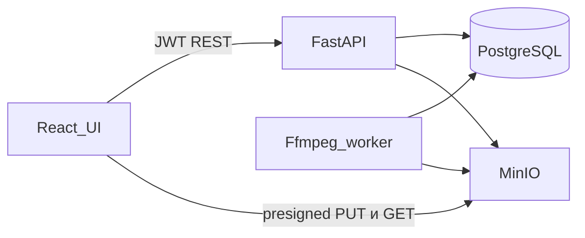

# Архитектура

Документ описывает систему так, чтобы её можно было реализовать без переписки. Продукт — максимально близкая копия YouTube, включая расположение и поведение интерфейса. Стек фиксирован: FastAPI, PostgreSQL, MinIO, React, один mp4.

## Контейнеры

`docker-compose.yml` задаёт пять сервисов без профиля. `bash deploy.sh` собирает их, применяет миграции и запускает `scripts/seed.py`. Повторный запуск сида не создаёт вторые демо-учётки.

- `api` — процесс FastAPI. Единственная точка входа HTTP: `backend/app/main.py`.
- `worker` — отдельный процесс той же кодовой базы. Из каталога `backend`, с тем же окружением, что у API: `python -m app.worker`. Один проход очереди без ожидания: `python -m app.worker --once`. Процесс забирает `pending`, ffmpeg снимает превью и переводит видео в `ready` или `failed`.
- `postgres` — пользователи, видео, права, лента, очередь задач.
- `minio` — файлы видео и превью.
- `frontend` — собранный React за nginx. Nginx отдаёт страницы и проксирует `/api` на контейнер API, поэтому браузер открывает один адрес. `CORS_ORIGINS` равен этому адресу.

Браузер ходит в API с JWT. Байты видео браузер отправляет и читает по короткой ссылке MinIO, не через процесс API.

## Слои API

Каталог `backend/app` делится на четыре слоя. Зависимости смотрят внутрь.

- `presentation` принимает HTTP, проверяет токен и роль, вызывает один сценарий, переводит доменную ошибку в статус. Swagger `/docs` строится из DTO этого слоя.
- `application` содержит сценарии. Он не знает про коды HTTP и про SQL.
- `domain` содержит сущности, перечисления (`Role`, `Visibility`, `VideoStatus`), правила «кто видит видео» и порты репозиториев и хранилища. Фреймворков в этом слое нет.
- `infrastructure` реализует порты: SQLAlchemy, Alembic, клиент MinIO, ffmpeg, хеш пароля, выпуск JWT.

Модули по темам ТЗ одинаковы во всех слоях, где тема нужна: `auth`, `videos`, `feed`, `channels`, `playlists`, `moderation`, `media`. Общие типы пользователя и роли объявляются в domain один раз.

Запреты:

- domain не импортирует FastAPI, SQLAlchemy, MinIO и ffmpeg;
- presentation не импортирует сессию базы и не пишет SQL;
- application не собирает HTTP-ответ.

## Поток загрузки и просмотра

1. Клиент вызывает `POST /videos` с названием, описанием и видимостью. Сценарий создаёт видео в статусе `uploading`, сам назначает ключ объекта и просит хранилище выдать короткий presigned PUT.
2. Браузер отправляет файл напрямую в MinIO и показывает прогресс по этой отправке.
3. Владелец вызывает `POST /videos/{id}/complete`. Чужой пользователь получает отказ. Сценарий ставит задачу в `media_jobs`.
4. Воркер скачивает объект, ffmpeg делает кадр-превью, превью кладётся в бакет, статус видео становится `ready`. Ошибка обработки даёт `failed` и текст в задаче.
5. `GET /videos/{id}/playback` проверяет видимость, список доступа и что ролик не скрыт от этого зрителя. Успех — короткий presigned GET. Лента этот адрес не отдаёт, пока статус не `ready`.

Несколько качеств и HLS не делаются. Раздачу диапазонами байтов даёт MinIO по presigned URL.

## Кто что видит

Правило живёт в domain и используется лентой, поиском, карточкой и выдачей ссылки на просмотр.

- В ленте и поиске только `public` и `ready`.
- `unlisted` открывается по id и в ленту и поиск не попадает.
- `private` видят владелец и пользователи из `video_grants`. Остальные получают ту же реакцию, что и на отсутствующий ролик: карточка и ссылка на просмотр не выдаются.
- `hidden` зритель не видит. Владелец видит карточку с пометкой.
- Неготовые статусы (`uploading`, `processing`, `failed`) в ленту не попадают. Владелец видит их у себя в канале.

## Сценарий, который должен заработать после реализации деплоя

Регистрация, загрузка файла, обработка до `ready`, открытие плеера, лайк и комментарий, который виден в списке под роликом. Демо-данные для ручной проверки создаёт `scripts/seed.py`: администратор, модератор, два автора, ролики, комментарии, лайк, открытая жалоба, одно private-видео с доступом.
